# ImageFactory

[](https://github.com/ngpayyappilly/image-factory/actions/workflows/ci.yml)

**Build a hardened VM image once. Prove it. Sign it. Promote that exact artifact through dev, canary and stable. Roll back by repointing, never by rebuilding.**

ImageFactory is a golden-image pipeline driven entirely from Git. One Packer build block and one set of
Ansible hardening produce a CIS-hardened image per OS flavor, blocking gates (goss, CIS score, trivy,
SBOM, boot test) decide whether it may ship, and a cosign-signed manifest records exactly what it is.
**AWS is the primary target** (AMIs, x86_64 and Graviton). Azure, GCP and VMware are optional and off by default.



<sub>Source: [docs/diagrams/imagefactory-architecture.mmd](docs/diagrams/imagefactory-architecture.mmd). The `.excalidraw` next to it opens at excalidraw.com.
Green = run on a real cloud account, blue = implemented and covered by offline tests but not yet run for real, amber dashed = not written, help wanted.</sub>

## Why this exists

- **Build once, promote the artifact.** Nothing in the promotion code builds anything; it only repoints a channel. Images and signed manifests are immutable.
- **Gates fail closed.** Missing evidence is "unmet", unparseable evidence is a failure, a test run with zero tests is a failure. Exceptions are time-boxed and approved in [config/exceptions.yaml](config/exceptions.yaml).
- **No shared mutable state.** Each platform build writes only its own record, one release step writes the manifest, and channel changes take a lock built on S3 conditional writes.
- **Cloud-neutral state.** Manifests and channel pointers live in a store; each cloud only *projects* them (AWS: SSM parameters, Azure: gallery tags, GCP: Secret Manager).
- **Architecture is part of the flavor.** `al2023` and `al2023arm` are different flavors with different versions, channels and signatures, so there is never an ambiguous "latest".

## Where things stand

| | Status |
|---|---|
| AWS: bootstrap, Packer build, gates, boot test, sign, publish to dev (Amazon Linux 2023) | Run once on a real account, then torn down |
| AWS: promotion, rollback and retention against real SSM and AMIs | Implemented, unit-tested, not run for real |
| Flavors: `al2023`, `al2023arm`, `rhel9`, `ubuntu2404`, `ubuntu2404arm` | Defined and validated offline; only `al2023` has been built |
| Azure and GCP runtime plugins, bootstrap and consumer Terraform modules | Implemented, offline-tested only |
| VMware | Packer variables only; promotion raises `PlatformNotImplemented` on purpose |
| Windows (`win2022`) | Unexecuted scaffold |

The full list of what is and is not built is in [CLAUDE.md](CLAUDE.md) under "Known gaps".

## Help wanted

Good places to start, roughly from smallest to largest:

- **Run a flavor for real** (RHEL 9, Ubuntu 24.04, AL2023 on Graviton) and report what breaks. This is the most valuable contribution right now.
- **Azure or GCP end-to-end run** against your own subscription or project, using the bootstrap in `terraform/azure-bootstrap` or `terraform/gcp-bootstrap`.
- **VMware runtime plugin** (`imagefactory/platforms/`) and a consumer Terraform module, following how `azure.py` and `gcp.py` are written.
- **Windows hardening**: replace the scaffold with a tested Pester + DSC CIS baseline.
- **More distributions** (Debian, Rocky/Alma, SLES) via `config/images.yaml` and a CIS vars file.
- **Missing operations**: CVE-triggered rebuilds, SLO dashboards and alerts, fleet drift reporting.

## Contributing in three steps

```bash
git clone https://github.com/ngpayyappilly/image-factory && cd image-factory
make setup && make check        # everything that runs offline, no cloud account needed
# make your change on a branch, add a test with it, open a pull request
```

`main` is protected: every change goes through a pull request and must pass the `check` and `unit-tests-py39` jobs. See [CONTRIBUTING.md](CONTRIBUTING.md), the [Code of Conduct](CODE_OF_CONDUCT.md) and [SECURITY.md](SECURITY.md) (report vulnerabilities privately). Read [CLAUDE.md](CLAUDE.md) for the invariants that must not be broken and [docs/ARCHITECTURE.md](docs/ARCHITECTURE.md) for how the pieces fit.

## Documentation

Design: `ImageFactory Design and Implementation Plan.pdf`. How the system fits together: [docs/ARCHITECTURE.md](docs/ARCHITECTURE.md). CI design: [docs/PIPELINES.md](docs/PIPELINES.md). Platforms: [docs/PLATFORMS.md](docs/PLATFORMS.md). AWS setup: [docs/AWS-BOOTSTRAP.md](docs/AWS-BOOTSTRAP.md).

## Quick start (no cloud needed)

```bash
make setup      # venv + deps
make check      # unit tests, packer validate (every flavor × platform), ansible syntax, terraform validate
```

## Standing it up on AWS (Phase 0)

1. **Bootstrap AWS** (bucket, KMS signing + EBS keys, least-privilege roles):
   `cd terraform/aws-bootstrap && terraform apply -var bucket_name=… -var 'builder_trusted_principal_arns=[…]' -var 'promoter_trusted_principal_arns=[…]'`
2. **Fill `config/images.yaml`** from the outputs and your network: `store.bucket`, `signing.key_ref`,
   `platforms.aws` (`build_subnet_id`, `ebs_kms_key_id`, `smoke_test.subnet_ids`, `share_with_accounts`).
3. **Pin the gate tooling.** Provide `TOOL_URLS_JSON` and `TOOL_SHA256_JSON` from your artifact mirror, keyed by CPU
   architecture then tool: `{"x86_64": {"goss": …, "trivy": …, "syft": …}, "arm64": {…}}` (only the architectures you build). Build scripts refuse unverified binaries. Point `TRIVY_DB_REPOSITORY` at your mirror for hermetic scans.
4. **Build one image:** `make build FLAVOR=al2023 PLATFORM=aws` (needs AWS credentials as the builder role).
5. **Wire up CI**, either GitHub Actions (below) or Azure DevOps (`pipelines/`).

   *(Azure DevOps option)* create the pipelines from `pipelines/` (variable group `imagefactory`, environments
   `imagefactory-canary` and `imagefactory-stable` with approvals, self-hosted pool `imagefactory-agents`).

## Real runs: keep environment values out of Git

Account IDs, bucket names, subnets and tool pins are environment-specific. Put them in files that Git ignores and point the CLI at them:

```bash
export IMAGEFACTORY_CONFIG=config/images.local.yaml     # also honoured by scripts/build.sh; --config still wins
set -a; source tool-pins.local.env; set +a              # TOOL_URLS_JSON / TOOL_SHA256_JSON (per CPU architecture)
export AWS_PROFILE=<your profile>
make build-setup                                        # once: .venv-build with Python >= 3.11 and the pinned ansible-core
make build FLAVOR=al2023 PLATFORM=aws                   # uses .venv-build when it exists
```

Builds need **Python >= 3.11** (the pinned `ansible-core` 2.18 requires it; the CIS roles need >= 2.16.1), so they use their own venv. `scripts/build.sh` checks this
first and installs the pinned CIS roles and collections itself.

`config/*.local.yaml`, `*.local.env` and `*.tfvars` are gitignored. Generate `images.local.yaml` from `config/images.yaml` and override `store`, `platforms.aws.regions`,
`ebs_kms_key_id` and `smoke_test.subnet_ids`; pin the tools with the checksums from the publishers (see `scripts/install-tools.sh` for how the other pins were verified).
Use one region while testing (cheaper and faster). A deployment that commits its own values should do so in a private repository.

## GitHub Actions

`.github/workflows/`: `ci.yml` (`make check` on every PR; make it a required check), `build.yml` (plan → build matrix → boot smoke test, sign, publish to dev), `promote.yml`
(promote or roll back, approval-gated), `maintenance.yml` (weekly retention). Builds run monthly from the
Patch-Tuesday+2 business day (retried daily until one releases, capped, then alerting) and on demand (`workflow_dispatch`, with a recorded reason for critical-CVE and other rebuilds).

Setup:
1. `terraform apply` the bootstrap with `-var github_repository=<org>/<repo>` (add `-var github_oidc_provider_arn=…` if the
   account already has a GitHub OIDC provider). Nothing is stored in GitHub: jobs trade their OIDC token for short-lived AWS credentials.
   The **builder** role is assumable only from runs on `main`; the **promoter** role only from jobs inside the
   `imagefactory-canary` / `-stable` / `-maintenance` environments, so AWS refuses a promotion that skipped approval.
2. Set repository **variables** from `terraform output github_actions_variables` (`AWS_REGION`, `BUILDER_ROLE_ARN`,
   `PROMOTER_ROLE_ARN`) plus `TOOL_URLS_JSON` and `TOOL_SHA256_JSON`. Optional: `IMAGEFACTORY_RUNNER`, `PACKER_VERSION`.
3. Create the environments `imagefactory-canary` and `imagefactory-stable` with **Required reviewers** and **Prevent self-review**
   (`imagefactory-maintenance` needs no reviewers). Restrict who can push to `main`.
4. **Runner choice.** Default is `ubuntu-24.04` (GitHub-hosted, pinned rather than `ubuntu-latest` so runner upgrades are deliberate): set `platforms.aws.restrict_build_sg_to_runner_ip: true` so the
   temporary SSH/WinRM rule opens only to the runner's IP, and build in a subnet with a public IP. For private subnets or
   Windows builds that need internal network paths, register a self-hosted runner and set `IMAGEFACTORY_RUNNER`.
5. Run **Build images** manually once (`flavors: al2023`) before relying on the schedule.

Actions are pinned to commit SHAs. Bump them deliberately.

## Azure (optional)

Azure is implemented end to end: Compute Gallery versions, channel tags, boot smoke test and retention (`imagefactory/platforms/azure.py`), a bootstrap stack
(`terraform/azure-bootstrap`) and a consumer module (`terraform/modules/golden-image-azure`). Setup and design are in
[docs/PLATFORMS.md](docs/PLATFORMS.md#azure). It is off by default (`platforms.azure.enabled`), and not yet run against a real subscription.

## GCP (optional)

GCP is implemented end to end: Compute Engine images, Secret Manager channel pointers, boot smoke test and retention (`imagefactory/platforms/gcp.py`), a bootstrap
stack with Workload Identity Federation (`terraform/gcp-bootstrap`) and a consumer module (`terraform/modules/golden-image-gcp`). Setup and design are in
[docs/PLATFORMS.md](docs/PLATFORMS.md#gcp). Off by default (`platforms.gcp.enabled`), and not yet run against a real project.

## CPU architectures

Architecture is part of the **flavor**, not a build option: `al2023` (x86_64) and `al2023arm` (arm64/Graviton) are separate
flavors with their own versions, channels, manifests and SSM pointers, so a consumer cannot resolve the wrong CPU architecture
(`module "image" { flavor = "al2023arm" }`). Set `arch:` per flavor in `config/images.yaml` (default `x86_64`); it selects the
source AMI (`{arch}` in `source_ami_name` plus an `architecture` AMI filter), the build and smoke-test instance type
(`t3` vs `t4g`), and the gate-tool binaries. The architecture is tagged on the AMI, written to `/etc/imagefactory-release`, and
recorded in the signed manifest. arm64 is **Linux on AWS only**; config load rejects arm64 on Azure/GCP/VMware or for Windows.
To add another: copy a flavor block, give it a new name and `arch`, and add that architecture's tool pins.

## How it works

| Concern | Where |
|---|---|
| Flavors, platforms, gates, bake times, retention | `config/images.yaml` (+ time-boxed `config/exceptions.yaml`) |
| Version `<flavor>-<YYYYMMDD>.<build>`, Patch Tuesday calendar | `imagefactory/versioning.py` |
| Build templates (one source per platform) | `packer/linux`, `packer/windows` |
| Shared Linux hardening | `ansible/` (baseline role + pinned ansible-lockdown CIS role) |
| Evidence → pass/fail gates | `packer/scripts/*/gates.*`, `imagefactory/gates.py` |
| Promotion, rollback, retention rules | `imagefactory/channels.py` |
| Cloud specifics behind one interface | `imagefactory/platforms/` |
| State (manifests, channel pointers) | S3 via `imagefactory/store.py`; platform-neutral |
| AWS channel pointers | SSM `/imagefactory/<flavor>/<channel>/ami_id` per region |
| Consumers | `terraform/modules/golden-image-aws` (follows `stable`; pinning is an explicit, warned variable) |

**Promotion rules enforced in code** (each has tests): required gates passing on *every* built platform;
signature verified; image available in every configured region; approver ≠ build author; stable needs
canary first, the 5-business-day bake (shortened to 1, never skipped, with `--expedite`), and an explicit
no-open-Sev-2 confirmation. Rollback repoints a channel to N-1 and refuses a missing/deprecated target.
Retention keeps N and N-1, deprecates the rest, deletes after 60 days (manifest and evidence stay).

**Using an image:** in Terraform `module "image" { source = ".../golden-image-aws", flavor = "al2023" }` → `module.image.ami_id`;
in a launch template `resolve:ssm:/imagefactory/al2023/stable/ami_id`.

## Day-to-day CLI

```bash
imagefactory status                                   # which version each channel serves
imagefactory promote  --flavor rhel9 --version rhel9-20261112.1 --to canary --approved-by you@org
imagefactory rollback --flavor rhel9 --channel stable --approved-by you@org --reason "boot failure"
imagefactory retention --flavor rhel9 [--apply]       # dry-run unless --apply
```

## Status: what is and is not verified

Verified offline (and in CI on every PR): the unit tests; `packer validate` for every flavor×platform; `ansible-playbook --syntax-check`;
`terraform validate` on every stack; shell syntax; `actionlint`.

**Run against real AWS** (one account, one region, 2026-10-23; since torn down): the bootstrap Terraform; real Packer builds that produced encrypted,
IMDSv2-only, correctly tagged AMIs; the least-privilege builder role; the gate scripts and ingestion on real evidence; `release` (boot smoke test, KMS signing
verified by a *separate* promoter identity, the SSM dev pointer, a `resolve:ssm:` launch); and the S3 locking and version reservation. The CIS role applied
cleanly (`ok=425 failed=0`), but **a CIS-hardened image never completed the gates**, so its compliance score has not been measured.

**Not yet run for real:** promotion to canary/stable, rollback and retention; multi-region replication (one region was tested); the SSM-join smoke check; the
GitHub build/promote/retention workflows (OIDC sign-in, the schedules); Windows; Azure and GCP. Expect first-run friction there. The exact procedure and what it
found are in [docs/AWS-BOOTSTRAP.md](docs/AWS-BOOTSTRAP.md).

Not built yet (from the plan): daily CVE detection, SLO dashboards/alerts and structured stage events, fleet
inventory and drift report, catalog integration, release notes/deprecation calendar tooling, the synthetic
6-hourly availability probe (`smoke_test` is the building block). See `docs/PLATFORMS.md` for per-platform status.
