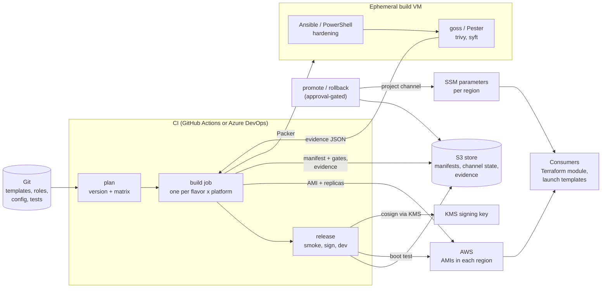
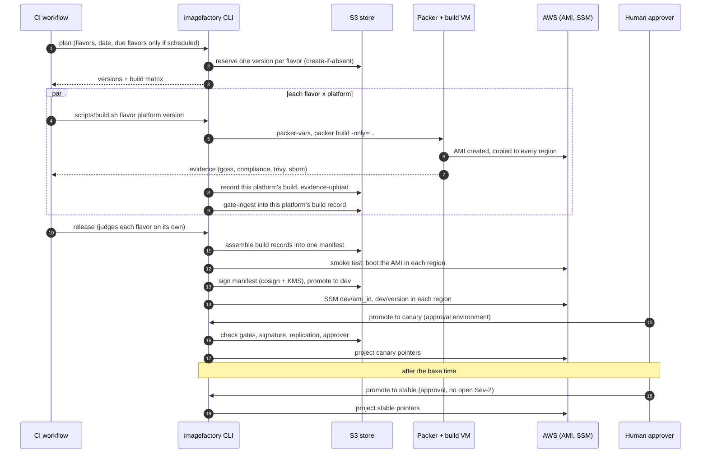
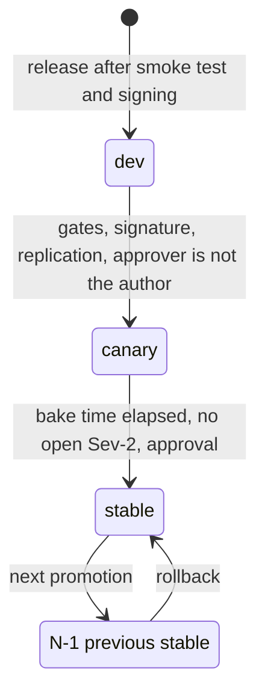
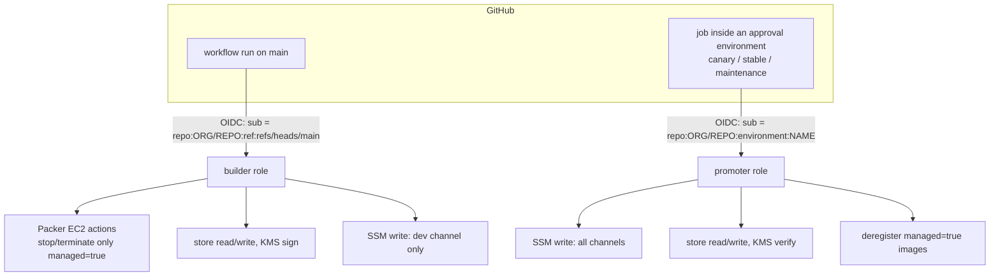

# ImageFactory architecture

How the pieces fit together, what state lives where, and why. For setup steps see the [README](../README.md);
for the CI workflows see [PIPELINES.md](PIPELINES.md); for per-platform status see [PLATFORMS.md](PLATFORMS.md). Diagrams are Mermaid and render on GitHub.

## 1. The idea in one paragraph

A CI workflow builds each image **once** with Packer, collects test and scan evidence from inside the build VM,
turns that evidence into pass/fail **gates**, boot-tests the published image, **signs** a manifest describing it,
and publishes it to the `dev` channel. People then **promote the same artifact** to `canary` and `stable`.
Consumers never name an image; they follow a channel (`stable` by default). Rollback is repointing a channel.
Nothing is patched in place and nothing is rebuilt for a different channel.

Principles that shape every design choice:

| Principle | Consequence in this repo |
|---|---|
| Build once, promote the artifact | `channels.py` never builds; it only moves pointers |
| Gates block, and fail closed | Missing evidence = gate unmet; unparseable evidence or zero tests = fail |
| State is platform-neutral | Manifests and channel state live in S3; clouds only *project* them |
| Platform differences stay thin | One Packer build block per OS family, one `Platform` plugin per cloud |
| Everything as code | Flavors, gates, bake times, retention, exceptions all in `config/` |
| No standing credentials | OIDC / assume-role, short-lived; nothing secret is baked into an image |

## 2. System overview



Two CI roles, two AWS identities (section 9): **build** (builder role) can create images and publish to `dev` only;
**promote** (promoter role) moves `canary` and `stable`, and only runs after a human approval.

## 3. Components

| Component | Where | Responsibility |
|---|---|---|
| Config | `config/images.yaml`, `exceptions.yaml` | Flavors, platforms, required gates, bake days, retention, time-boxed exceptions |
| CLI + core | `imagefactory/` | All logic that is not Packer: versions, manifests, gates, signing, promotion, retention |
| Platform plugins | `imagefactory/platforms/` | Everything cloud-specific behind `Platform` (Packer vars, replication check, channel projection, smoke test, deregistration) |
| Packer templates | `packer/linux`, `packer/windows` | One `build` block per OS family, one `source` per platform; selected with `-only` |
| In-VM scripts | `packer/scripts/{linux,windows}` | Cleanup, evidence collection, sealing, sysprep |
| Hardening | `ansible/` (Linux), `packer/scripts/windows/20-harden.ps1` | Shared across platforms; the Packer source is the only platform difference |
| Test suites | `tests/goss`, `tests/pester` | Functional checks and a CIS Level 1 subset; they *produce evidence*, they do not decide pass/fail |
| AWS infra | `terraform/aws-bootstrap` | Store bucket, KMS keys, builder and promoter roles, GitHub OIDC trust |
| Consumer module | `terraform/modules/golden-image-aws` | Resolves a channel to an AMI; pinning is an explicit, warned variable |
| CI definitions | `.github/workflows/`, `pipelines/` | Thin wrappers that call `scripts/build.sh` and the CLI |

The CI layer is deliberately thin: build logic lives in `scripts/build.sh` and the CLI so GitHub Actions and Azure DevOps
run identical steps.

## 4. Lifecycle of one image



### 4.1 Planning and versioning
`imagefactory plan` computes one version per flavor so every platform build of that flavor shares it.
Format `<flavor>-<YYYYMMDD>.<build>` (e.g. `al2023-20261112.1`); the build number is the highest existing
build for that flavor and date, plus one, counting **every started build, released or not** (an unreleased
build still owns its AMI name). The version is **reserved atomically** (a create-if-absent write of
`builds/<flavor>/<version>/_reserved.json`), so two overlapping runs are always handed different versions. Azure and GCP cannot hold that string as a name, so `Version.azure`
(`2026.1112.1`) and `Version.gcp` (`al2023-20261112-1`) map it; the canonical version is always stored in a
tag or label. A version is never reused.

**Monthly schedule with catch-up** (`schedule.py`). The build day is two business days after Patch Tuesday
(`versioning.scheduled_build_date`; weekends only, holidays are not modelled). A flavor is *due* from the build day until a
build of it has been **released** that month, so a failed, skipped or delayed run is retried by the next daily trigger.
Attempts are counted from the versions started since the build day and capped by `schedule.max_attempts_per_month`
(default 3); after that the flavor is *exhausted* and the pipeline's alert job fails the run instead of retrying forever or doing
nothing. A manual rebuild after the build day (for example a critical CVE) counts as that month's release. Event-driven and
manual rebuilds use the same pipeline.

### 4.2 Inside the build VM
Order matters; each step exists for a reason:

| Linux step | Why here |
|---|---|
| Wait for cloud-init | Don't race first-boot configuration |
| Ansible: updates, CIS role, baseline | Shared hardening; our baseline runs *last* so it overrides the CIS role where they conflict |
| `cleanup.sh` | Removes host keys, machine-id, caches, logs **before** tests/scans so they see what will ship |
| Upload goss suites | |
| `gates.sh` | Downloads pinned goss/trivy/syft (SHA256-verified), writes `goss.json`, `compliance.json`, `trivy.json`, `sbom.json`. Uses a throwaway SSH host key because `sshd -T` will not run without one |
| Download evidence | Back to the CI job |
| `seal.sh` | Removes tooling, evidence and the build user's SSH key. Last, because Packer needs that key until now |

Windows follows the same contract: updates, restart, hardening (a CIS starter subset), Pester suites exported in the
same goss-shaped JSON, syft/trivy, then platform sysprep (EC2Launch v2 on AWS). The Windows track is an unexecuted scaffold.

`gates.sh` produces evidence but does **not** decide pass/fail, so a failing image is still fully recorded.

### 4.3 From evidence to gates
`gate-ingest` evaluates each report that exists (`gates.py`):

| Gate | Evidence | Passes when |
|---|---|---|
| `goss` | `goss.json` | Tests ran and none failed |
| `compliance` | `compliance.json` | Score >= `promotion.compliance_min_score` (default 0.90), after discounting active exceptions |
| `vuln_scan` | `trivy.json` | No CRITICAL/HIGH finding that lacks an active exception |
| `secrets` | `trivy.json` | No secret findings |
| `sbom` | `sbom.json` | CycloneDX or SPDX with at least one component |
| `smoke` | recorded by `release` | The AMI booted in every region (and registered with SSM if a profile is configured) |

Rules worth knowing:
- **Per platform, then aggregated.** Results are stored per platform (`gate_results`); a gate passes only when *every platform the image was built for* has passed it (`Manifest.refresh_gates`). Adding a platform later re-opens gates it has no evidence for.
- **Absent evidence is not a pass.** An absent report leaves the gate unmet; an unparseable one fails it.
- **Exceptions are time-boxed.** `config/exceptions.yaml` entries need `id`, `gate`, `reason`, `approved_by`, `expires`; expired ones stop applying automatically.

### 4.4 Release
`imagefactory release` judges **each flavor on its own**; one failing flavor never blocks another. For a flavor it:
1. **assembles** the per-platform build records into one manifest, and skips the flavor if any enabled platform has no
   record or the records disagree about what was built (commit, baseline, architecture);
2. skips it unless every pre-release gate (all required gates except `smoke`) is green on every platform;
3. boot-tests it on every platform (`smoke`);
4. signs the manifest **once** and promotes it to `dev` as `ci:<run id>`.

The command prints one line per flavor and exits non-zero if **any** flavor was not released, so the run is red while the ready
flavors are already out. Re-running it is safe: a released flavor is reported as already released, and a flavor that failed its
smoke test can be retried. A failing image is never signed, so it can never pass the signature check required for `canary`.

## 5. Channels and promotion



| Channel | Who consumes it | Entry rules (enforced in `channels.py`) |
|---|---|---|
| `dev` | ImageFactory team, build tests | Manifest exists; no required gates |
| `canary` | Opted-in non-prod fleets | All required gates passing on every platform; signature verifies; image available and tagged correctly in every configured region; approver is not the build author |
| `stable` | Everyone, and the Terraform module default | Everything for canary, **plus** the version is currently in canary, the bake has elapsed (5 business days; `--expedite` shortens to 1, never skips), and `--no-open-sev2` was explicitly confirmed |

**Ordering and atomicity.** `_set()` projects the pointer to the platform first and writes channel state only afterwards,
so a failed projection leaves state unchanged. Channel state keeps `version`, `previous`, `promoted_at`, `promoted_by`,
`reason` and the last 20 history entries. Re-promoting the version a channel already serves does not make it its own N-1.

**Rollback** repoints a channel to `previous`. It refuses when there is no previous, when the target is deprecated, or when
the target is no longer available in every region. After a rollback, `previous` is the version that was pulled, so a second
rollback is an explicit roll-forward. Running VMs are never touched; teams redeploy on their own cadence.

**Retention** (`retention_plan`/`retention_apply`): supported = whatever any channel points at, plus the previous stable
(N and N-1). Everything else is marked deprecated; deprecated images are deregistered (AMI and snapshots) after
`retention.deprecated_grace_days` (60). Builds that **never released** (a gate failed, so there is no manifest) are cleaned up
separately and sooner: their AMIs and snapshots are deregistered after `retention.unreleased_grace_days` (7). Manifests, build
records, signatures and evidence are kept. The weekly job applies it; manual
runs are a dry run unless `--apply`.

## 6. State and data model

Platform-neutral state lives in the store (S3 in production, a local directory for development and tests):

```
s3://<bucket>/
  builds/<flavor>/<version>/<platform>.json   one per platform build: its images and gate results (written by that build only)
  builds/<flavor>/<version>/_reserved.json    the version reservation made by `plan`
  manifests/<flavor>/<version>.json           the released image: assembled from the build records, then signed
  channels/<flavor>/<channel>.json            what each channel serves, previous, history
  evidence/<flavor>/<version>/<source>/*      raw goss/trivy/sbom reports (expires via lifecycle; manifests do not)
  locks/<name>.json                           CI-system-neutral locks (see below)
```

**Why build records are separate from the manifest.** Platform builds of one flavor run in parallel. If each did a
read-modify-write of one shared manifest, two finishing together could lose an update. Instead each platform build owns exactly one
object (`builds/.../<platform>.json`), so concurrent builds never write the same key, and `release` is the **single writer** of
the manifest. Re-recording the same version and platform is refused (images are immutable; a rebuild gets a new version).
A version with build records but no manifest is an *unreleased build*; retention cleans those up (section 5).

**Conditional writes and locks.** The store supports create-if-absent and replace-if-unchanged (S3 `If-None-Match` / `If-Match`).
They back the version reservation and a small lock (`imagefactory lock acquire|release`), a record with an owner and an expiry so a
killed run cannot block forever. Promotion, rollback and retention take `channels-<flavor>`, so retention never races a
promotion; Azure DevOps also takes `build` to serialize build runs (GitHub uses a concurrency group).

**Manifest** (`manifest.py`):

| Field | Meaning |
|---|---|
| `version`, `flavor`, `arch` | Identity. `arch` defaults to `x86_64` so older manifests still load |
| `baseline_version`, `commit`, `pipeline_run`, `author`, `created_at` | Provenance |
| `images` | `platform -> location -> image reference` (AWS: `region -> ami-id`) |
| `gates`, `gate_results` | Aggregated and per-platform gate results (lifecycle state) |
| `signature`, `deprecated_at` | Lifecycle state |

**What the signature covers.** `canonical_bytes()` signs identity and provenance (everything except `gates`,
`gate_results`, `signature`, `deprecated_at`). Changing which AMIs make up the image invalidates the signature;
recording a gate result does not. Signing is KMS-backed cosign (`awskms:///alias/imagefactory-signing`), and promotion
verifies it. Signatures are **not** uploaded to the public Sigstore transparency log (`--tlog-upload=false`; verification passes
`--insecure-ignore-tlog=true`): cosign publishes there by default, which a private pipeline must not do silently, and it would make
every promotion depend on a third-party service. Trust rests on the KMS key. Build records are refused once the version has been released.

**AWS projection.** For each region: `/imagefactory/<flavor>/<channel>/ami_id` (SSM data type `aws:ec2:image`, so
`resolve:ssm:` works in launch templates) and `/imagefactory/<flavor>/<channel>/version`. SSM is regional, so every
configured region is written. AMIs and snapshots carry tags `imagefactory:{version,flavor,arch,baseline,commit,managed}`;
the `managed` tag is what scopes the IAM permissions to stop, terminate and deregister.

## 7. Platforms

Cloud specifics sit behind `Platform` (`platforms/base.py`):

| Method | Purpose |
|---|---|
| `packer_vars(flavor_cfg, version)` | Map `config/images.yaml` onto this platform's Packer variables |
| `images_from_packer(artifact_id)` | Parse the Packer manifest into `{location: image ref}` |
| `verify_available(version, images)` | Check the image exists, is available, is correctly tagged, and exists in every configured location |
| `set_channel(...)` | Project a channel pointer natively |
| `smoke_test(...)` | Boot the distributed image and check it comes up |
| `deregister(...)` | Retention |

AWS, Azure and GCP implement all of it. VMware implements only `packer_vars`; the rest raise `PlatformNotImplemented`, so
enabling one builds fine but promotion fails loudly rather than silently skipping. Details and the status table are in
[PLATFORMS.md](PLATFORMS.md).

## 8. Flavors and CPU architecture

A **flavor** is one OS, one architecture, one versioned and signed image stream. Architecture is part of the flavor, never a
build-time switch:

| Flavor | OS family | Arch | Platforms |
|---|---|---|---|
| `al2023` | Linux | x86_64 | AWS |
| `al2023arm` | Linux | arm64 (Graviton) | AWS |
| `rhel9` | Linux | x86_64 | AWS, Azure, GCP, VMware |
| `win2022` | Windows | x86_64 | AWS, Azure (scaffold) |

Because `al2023` and `al2023arm` have different names they have separate versions, manifests, channels and SSM pointers, so a
consumer cannot resolve the wrong CPU architecture. The `arch` field drives: the source AMI (`{arch}` in the name pattern plus an
`architecture` AMI filter), the build and smoke-test instance types (`t3` vs `t4g`), and which gate-tool binaries are used
(`tool_urls[arch][tool]`). arm64 is supported for **Linux on AWS only**; `Config.validate` rejects it elsewhere. A platform is
used for a flavor only if the flavor lists it **and** it is enabled under `platforms:` (only AWS is enabled by default).

## 9. Identity, access and trust



- **No stored cloud keys.** GitHub jobs exchange their OIDC token for short-lived credentials (Azure DevOps agents assume
  the roles via `scripts/assume-role.sh`).
- **Separation of duties, enforced by AWS.** The builder can publish to `dev` only. The promoter role can be assumed only from
  jobs running inside an approval environment, so promotion without review has no credentials to run with. The CLI also
  rejects the build's author as approver (scheduled builds record the author as `scheduler`).
- **Hermetic and verified inputs.** Gate tooling is downloaded only with a pinned SHA256; Actions are pinned to commit SHAs;
  the CIS roles are pinned to reviewed tags; the optional `distro_releasever` pins an Amazon Linux repository snapshot.
- **Secrets never touch the image.** Build credentials are short-lived, the build VM has no instance profile, host keys and the
  build user's SSH key are removed, and trivy's secret scan is a blocking gate.
- **Encryption.** AMIs are built encrypted; sharing an encrypted AMI across accounts requires the customer-managed EBS key the
  bootstrap creates. The store bucket is KMS-encrypted and versioned.

## 10. Failure modes

| Failure | What the system does |
|---|---|
| A gate fails or evidence is missing | The build job fails; `release` skips that flavor (others still release); it stays unsigned and cannot be promoted. Evidence is still uploaded |
| A platform build crashed before recording itself | `release` skips the flavor ("no build recorded for platform"); the other flavors release |
| The monthly build fails or the schedule is skipped | The next daily trigger retries (up to `max_attempts_per_month`), then the alert job fails the run |
| A build never released | It has no manifest or channel; retention deregisters its AMIs after `retention.unreleased_grace_days` (7) |
| Smoke test fails | `release` stops before signing; build instances are always terminated |
| Replica region missing or still pending | Promotion and rollback refuse; the pointer is not changed |
| Pointer projection fails mid-promotion | Channel state is unchanged (projection happens first) |
| Bad image reaches stable | Roll back (repoint to N-1); post-incident review adds the gate that should have caught it |
| Tool download or checksum mismatch | `gates.sh` exits 1; evidence is incomplete, so gates stay unmet |
| Credentials expire during a long build | Builder sessions allow up to 4 hours; OIDC sessions cannot be refreshed, so builds must finish inside that |
| Two runs race | Versions are reserved atomically (distinct versions even if runs overlap); GitHub concurrency groups and the store lock serialize builds and per-flavor channel changes |
| Two platform builds finish together | Each writes only its own build record; nothing is overwritten |

## 11. Extending

- **New flavor:** add a block under `images:` in `config/images.yaml` (name, `os_family`, `arch`, `platforms`, per-platform block,
  `cis_role` for Linux) and the architecture's tool pins. `make check` validates it.
- **New required gate:** add an evaluator in `gates.py`, register it in `ingest`, list it in `promotion.required_gates`, and add tests.
- **New platform:** implement `Platform`, register it in `platforms/__init__.py`, add a Packer source and variables, and a consumer
  module. Keep `PlatformNotImplemented` for anything unfinished.
- **Different scanner or standard:** replace the evidence producer, keep the evidence shape and the gate name. The org's mandated
  standard is still an open decision.

## 12. Not built yet

Daily CVE detection, SLO dashboards and alerting, fleet inventory and drift report, catalog integration, the 6-hourly
availability probe (`smoke_test` is its building block), Git tagging of versions, GCP/VMware runtime plugins, and an
executed Windows track. The AWS path has run against a real account once (see the README, "Status"); promotion beyond `dev`, rollback,
retention and multi-region replication have not.
