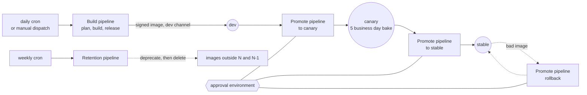
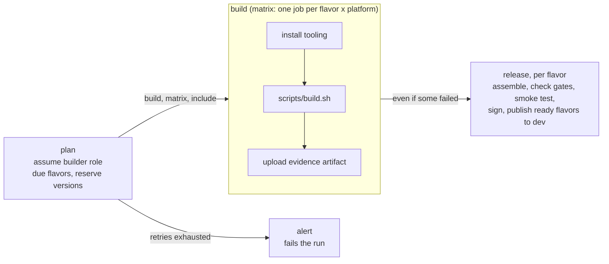

# Pipelines

How CI builds, publishes and promotes images. There are **two equivalent implementations**: GitHub Actions
(`.github/workflows/`) and Azure DevOps (`pipelines/`). Use one. For what the steps do to the data see
[ARCHITECTURE.md](ARCHITECTURE.md); for first-time setup see the README ("GitHub Actions").

## 1. Design

| Decision | Why |
|---|---|
| **CI is thin.** Workflows call `scripts/build.sh` and the `imagefactory` CLI; logic is not written in YAML | GitHub and Azure DevOps run identical steps, the logic is unit-tested, and you can reproduce a run on a workstation |
| **Four pipelines, not one** | Build and promotion have different cadences (a canary bake is 5 business days, so a single run would stay open for a week), different identities, and different approval needs |
| **Build never promotes past `dev`** | Promotion to canary/stable is a separate, approval-gated, human-triggered run that never rebuilds |
| **One version per flavor, decided up front** | A `plan` job picks it once so every platform build of that flavor shares it |
| **A failing image is never signed** | The `release` job only runs when every build passed every gate; unsigned images cannot pass the signature check for canary |
| **Short-lived credentials only** | GitHub: OIDC. Azure DevOps: assume-role at the start of each step. No keys are stored |
| **Separate roles for build and promote** | The builder can publish to `dev` only; the promoter role is reachable only through an approval gate |

| Pipeline | GitHub Actions | Azure DevOps | Trigger | AWS role |
|---|---|---|---|---|
| CI (validation) | `ci.yml` | not provided | Pull requests, pushes to `main`, manual | none |
| Build | `build.yml` | `pipelines/build.yml` | Daily cron (acts only on the monthly build day) and manual | builder |
| Promote / roll back | `promote.yml` | `pipelines/promote.yml` | Manual only | promoter |
| Retention | `maintenance.yml` | `pipelines/maintenance.yml` | Weekly cron and manual | promoter |

## 2. CI (validation)

Runs on every pull request, every push to `main`, and on demand. It runs the same `make check` you run locally:
unit tests, `packer validate` for every flavor x platform (including the optional platforms, using vars generated from the
config), Ansible syntax check, `actionlint`, and `terraform validate` + `fmt`. It also runs the unit tests on Python 3.9, the oldest
supported version (the main job uses 3.12).

- **No cloud access at all.** `permissions: contents: read`, no `id-token`, no AWS role, no secrets. A pull request, including one
  from a fork, cannot reach AWS or any build role from this workflow. It uses the `pull_request` event, never
  `pull_request_target`.
- **Newer pushes cancel older runs** of the same ref.
- **Make it required.** Add the jobs `CI / check` and `CI / unit-tests-py39` as required status checks on `main`; the
  workflow does not enforce anything by itself. Because the build roles trust only `main`, this is also the gate on what can build
  and sign.
- **What it does not prove.** It cannot build an image, boot an instance or exercise AWS. It catches config, template, syntax and
  logic mistakes (for example an unsupported architecture combination or a Packer variable that no longer maps); the first real
  build still needs a human.
- **Azure DevOps** has no equivalent file. If you use ADO with GitHub, add a PR trigger pipeline that runs `make setup check`
  (install Packer and Terraform on the agent first); with Azure Repos, use a branch policy.

## 3. Build pipeline

Builds, gates, boot-tests, signs and publishes to `dev`.

### 3.1 Triggers and inputs
- **Schedule (with catch-up):** daily at 06:00 UTC on weekdays. A scheduled run plans only the flavors whose monthly build is
  **due**: from the build day (two business days after Patch Tuesday) until a build of that flavor has been *released* that
  month. So a failed, skipped or delayed run is retried by the next daily trigger, instead of waiting a month. Retries are capped at
  `schedule.max_attempts_per_month` (default 3); after that the **alert** job fails the run so someone is notified, and the
  flavor is not retried again until it is run manually or the month rolls over. When nothing is due, the run is a no-op
  success. (Details in [ARCHITECTURE.md §4.1](ARCHITECTURE.md#41-planning-and-versioning).)
- **Manual** (`workflow_dispatch` / "Run pipeline"): always builds. Inputs: `flavors` (comma separated, empty = all) and
  `reason` (`manual`, `critical-cve`, `baseline-change`, `new-os-minor`). The reason is logged with the run; GitHub/ADO run
  history is the audit trail.

### 3.2 Jobs

| Job | What it does | Output / effect |
|---|---|---|
| **plan** | Assumes the builder role; on a scheduled run selects the due flavors; **reserves** one version per flavor (atomically) | `build` (true/false), `matrix` (map used by release), `include` (job matrix), `exhausted` (flavors out of retries). One version per flavor, shared by all its platform builds |
| **build** (matrix) | Installs Python, ansible-core, Packer; assumes the builder role (session up to 4 h); runs `scripts/build.sh <flavor> <platform> <version>` | AMIs in every region, this platform's **build record**, uploaded evidence, per-platform gate results. Fails if any gate fails |
| **release** | Runs even if some builds failed. Assumes the builder role (installs cosign); runs `imagefactory release --matrix` | **Per flavor:** assemble the build records, require every pre-release gate green, boot smoke test, **one** signature, publish to `dev`. A flavor that is not ready is reported and fails the job but never blocks the others |
| **alert** | Only when a flavor exhausted its retries | Fails the run with an error naming the flavors |

`scripts/build.sh` is the heart of the build job, in order: generate Packer vars from config → install the pinned CIS roles
(Linux) → `packer init` / `packer build -only=<source>` → `manifest-create` (record this platform's build in its **own** object) → `evidence-upload` (to S3, even
when a gate will fail) → `gate-ingest` (exit non-zero if any gate failed).

### 3.3 Concurrency, parallelism, timeouts
- **Correctness does not depend on serialization.** Versions are reserved atomically, and each platform build writes only its own
  record, so overlapping runs get distinct versions and cannot overwrite each other. Serialization below is to avoid duplicate
  work and cost.
- **GitHub:** concurrency group `imagefactory-build` (one build run at a time); `max-parallel: 2`; `fail-fast: false` so
  sibling builds finish and clean up their instances; 120 minute job timeout. A queued run waits, but only one run can wait: a
  newer pending run replaces an older pending one.
- **Azure DevOps** has no concurrency groups, so the **Plan** job takes a `build` lock in the store
  (`imagefactory lock acquire`, waits up to 30 minutes, expires after 6 hours so a killed run cannot block forever) and the
  **Unlock** stage always releases it. `maxParallel: 2`, 120 minute timeout.

### 3.4 Evidence
Each build job publishes `reports-<flavor>-<platform>` as a CI artifact (90 days on GitHub), and uploads the same files to
`evidence/<flavor>/<version>/<source>/` in the store bucket, where a lifecycle rule expires them. The manifest and signature are
kept permanently.

## 4. Promote pipeline

Moves an **existing** image to `canary` or `stable`, or rolls a channel back. It never builds.

| Input | Meaning |
|---|---|
| `action` | `promote` or `rollback` |
| `flavor`, `version` | What to promote (`version` is ignored for rollback) |
| `to` | Target channel: `canary` or `stable` |
| `expedite` | Critical-CVE path: canary bake shortened from 5 business days to 1 (never skipped) |
| `no_open_sev2` | Explicit confirmation that no open Sev-2 is tied to the image; **required** for stable |
| `reason` | Required for rollback |

The job runs inside the environment `imagefactory-<to>` (`canary` or `stable`). Required reviewers on that environment are the
human approval. After approval the job assumes the **promoter** role, and AWS only allows that from inside those environments.

Then the CLI enforces the rules (details in [ARCHITECTURE.md §5](ARCHITECTURE.md#5-channels-and-promotion)): required gates on every
platform, signature, availability in every region, approver is not the build's author, and for stable also "already in canary",
bake elapsed, Sev-2 confirmation. The approver recorded is the person who triggered the run, so **the approver should be the one
who runs the promotion**, not the author of the build.

Rollback is the same pipeline with `action: rollback`; it repoints the channel to the previous version and prints a reminder to
publish a notice and open a post-incident review. Both CI systems take the store lock `channels-<flavor>` around the change
(waits up to 10 minutes), the same lock retention takes, so a promotion or rollback never races another one or a retention run.

## 5. Retention pipeline
Weekly (Sunday 05:00 UTC), in the `imagefactory-maintenance` environment, as the promoter role. For every flavor it runs
`imagefactory retention`: deprecate versions outside N and N-1, delete those deprecated for 60+ days (AMI and snapshots; manifests
and evidence stay). Scheduled runs **apply**; manual runs are a dry run unless `apply` is ticked.

## 6. Authentication and access

| Pipeline job | AWS role | How it is obtained | Can do |
|---|---|---|---|
| build: plan, build, release | builder | GitHub: OIDC, only from runs on `main`. ADO: `scripts/assume-role.sh` | Create/copy/tag AMIs and stop/terminate only `managed=true` instances; read/write the store; KMS sign; write SSM for **`dev` only** |
| promote, retention | promoter | GitHub: OIDC, only from jobs inside `imagefactory-canary` / `-stable` / `-maintenance`. ADO: `assume-role.sh` | Write SSM for all channels; read/write the store; KMS verify; deregister `managed=true` images |

On GitHub nothing is stored: each job exchanges its OIDC token for credentials. The trust conditions are created by
`terraform/aws-bootstrap`. On Azure DevOps the agents' own AWS identity must be allowed to assume the two roles; credentials are
placed straight into the step's environment, never into logs or pipeline variables.

## 7. What you must configure

**GitHub:** repository variables `AWS_REGION`, `BUILDER_ROLE_ARN`, `PROMOTER_ROLE_ARN` (from
`terraform output github_actions_variables`), `TOOL_URLS_JSON`, `TOOL_SHA256_JSON` (keyed by CPU architecture, then tool);
optional `IMAGEFACTORY_RUNNER` (runner label, default `ubuntu-latest`) and `PACKER_VERSION`. Environments
`imagefactory-canary` and `imagefactory-stable` with Required reviewers and "Prevent self-review", plus
`imagefactory-maintenance`. Protect `main`.

**Azure DevOps:** Library variable group `imagefactory` (`BUILDER_ROLE_ARN`, `PROMOTER_ROLE_ARN`, `AWS_DEFAULT_REGION`,
`TOOL_URLS_JSON`, `TOOL_SHA256_JSON`); environments `imagefactory-canary` and `imagefactory-stable` with approvals; a self-hosted
pool named `imagefactory-agents`.

**Runner prerequisites.** GitHub-hosted runners get Python, ansible-core, Packer and cosign per job from pinned Actions. The
Azure DevOps pipelines need the agent to have `python3`, `git` and the AWS CLI; **Packer and cosign are installed by the pipeline**
with `scripts/install-tools.sh` (Linux; pinned versions, each download verified against a pinned SHA256 and refused on mismatch).
The same script works on self-hosted GitHub runners. To bump a version, change the pin and its checksums together; the file says
where the publisher's checksums come from.
Builds also need network reach to the build VM: GitHub-hosted runners need a public subnet and
`platforms.aws.restrict_build_sg_to_runner_ip: true`; private subnets or Windows builds need a self-hosted runner
(`IMAGEFACTORY_RUNNER`).

## 8. GitHub Actions vs Azure DevOps

| | GitHub Actions | Azure DevOps |
|---|---|---|
| Authentication | OIDC, no stored credentials | Assume-role from the agent's AWS identity |
| Promotion approval | Environment reviewers, enforced again by AWS trust | Environment approvals; role trust is not tied to the environment |
| Serialization | `concurrency` groups, plus the store lock for channels | Store lock (`build`, `channels-<flavor>`) with an always-run Unlock stage |
| PR validation | `ci.yml` | Not provided |
| Tool installation | Per job (pinned Actions) | `scripts/install-tools.sh` (pinned, checksum-verified) |
| Dynamic matrix | `fromJSON(plan.include)` | Runtime matrix expression from the plan output |
| Third-party code | Actions pinned to commit SHAs | None |

Behaviour is the same in both: catch-up scheduling, per-flavor release, atomic version reservation, build records. The remaining
differences are authentication, how approval is enforced, and PR validation (GitHub only).

## 9. Common runs

| Goal | Run |
|---|---|
| Monthly cycle | Nothing to do for the build; it runs on the build day. Then promote to canary, wait out the bake, promote to stable |
| Critical CVE, out of band | Build manually with `reason: critical-cve`; promote to canary; promote to stable with `expedite` and `no_open_sev2` |
| A scheduled build failed or was missed | Nothing; the next daily run retries it (up to 3 attempts per month). If the alert fires, fix the cause and build manually (`reason: manual`) |
| Pull back a bad stable image | Promote pipeline, `action: rollback`, `to: stable`, with a reason |
| Preview what retention would delete | Retention pipeline, manual, `apply` unticked |

## 10. Failure behaviour

| Situation | Result |
|---|---|
| A gate fails in a build job | That job fails; `release` skips that flavor (it stays unsigned and cannot reach canary) and **still releases the others**; the release job is red. Evidence is still uploaded and attached |
| A build job crashes before recording itself | `release` reports "no build recorded for platform" and skips that flavor |
| Nothing is due on a scheduled run | `plan` sets `build=false`, everything else is skipped (a no-op success) |
| The monthly build keeps failing | Retried each day up to the cap, then the `alert` job fails the run |
| Smoke test fails | `release` fails that flavor before signing; test instances are terminated; the failed build's AMIs are removed by retention after 7 days |
| Build session or job exceeds its limit | Job fails; Packer's temporary resources are cleaned up by Packer where it can, and `managed=true` tags make stragglers easy to find |
| Promotion rule not met | The CLI exits non-zero with the reason; no pointer or state changes |
| Approver is the build's author | Rejected by the CLI |

## 11. Security notes
- Workflow inputs and matrix values are passed to scripts through `env:`, never interpolated into shell, to avoid script
  injection.
- Actions are pinned to commit SHAs (with the version in a comment). Bump deliberately.
- The builder role cannot be assumed from pull requests or feature branches, and cannot touch `canary` or `stable`.
- Gate tooling is downloaded only with a pinned SHA256.

## 12. Known limitations

1. **Never run against a real AWS account or CI system yet.** The GitHub workflows pass `actionlint` (and `make check` passes from a
   clean checkout with no AWS access), the Azure DevOps YAML parses, and `scripts/install-tools.sh` was exercised against the real
   downloads (checksum verification, extraction and tamper refusal) but not executed on a Linux agent. Expect first-run fixes (for example
   runner network reach, tool pins, and Azure DevOps runtime-expression details).
2. **Locks rely on S3 conditional writes** (`If-None-Match` / `If-Match`), available in current S3 and boto3 (>= 1.36). They use the
   store bucket's normal write permissions. A lock held by a killed run is released only when its expiry passes (6 h for builds, 30 min
   for promotions, 60 min for retention).
3. **A flavor that exhausts its retries is not retried again that month** until it is run manually. This is deliberate, so a
   persistent failure does not burn builds; the alert is the signal.
4. **Holidays are not modelled** in the build-day calculation (weekends only).
5. **No PR validation for Azure DevOps** (GitHub has `ci.yml`).
6. **Not built:** notifications beyond the run failing (Slack/Teams/email), an automatic daily CVE-triggered build, and automatic
   promotion to canary after `dev`.
